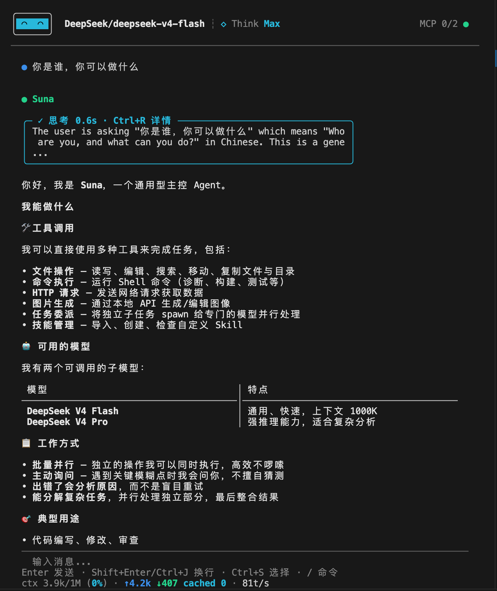
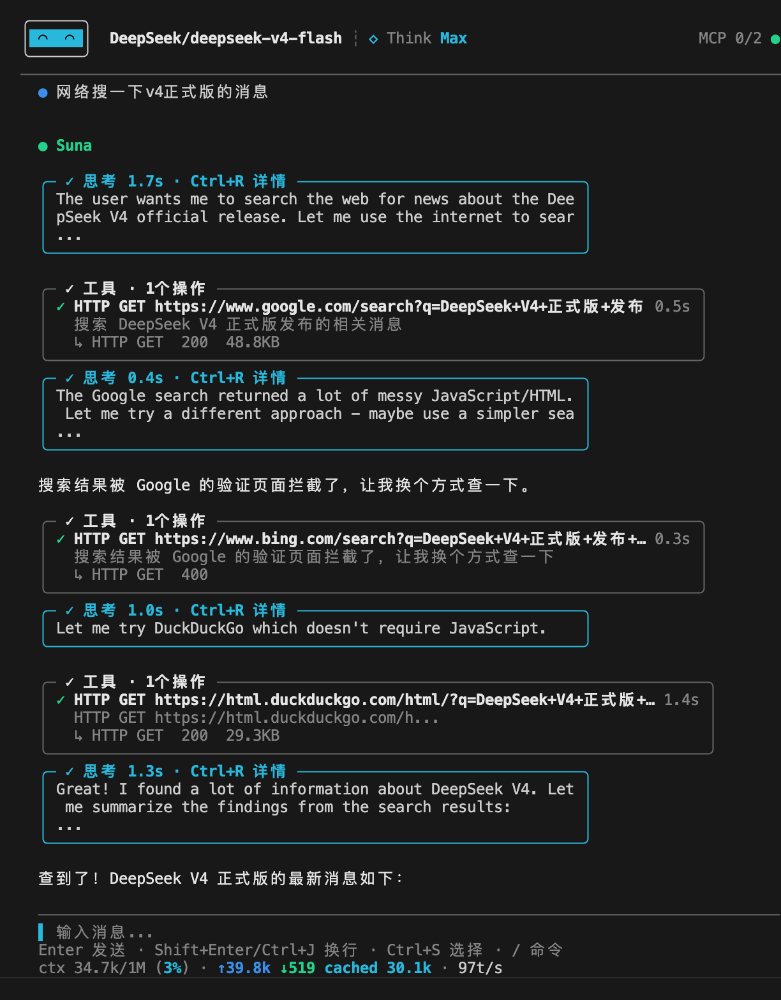

# Suna

[](https://go.dev) [](LICENSE) [](https://github.com/alanchenchen/suna/releases)

> A local-first, general-purpose AI agent: choose your models, delegate bounded work, and use the terminal or official Web client for files, code, research, and automation.

Suna runs the Agent, tools, and session management on your machine. Connect OpenAI, Anthropic, or OpenAI-compatible model services, and let the main Agent delegate focused tasks to different models with explicit context and tool access.

Use the built-in TUI or [Suna App](https://github.com/alanchenchen/suna-app), the official Web client for the same Runtime.

[Quick start](#quick-start) · [Official Web client](#official-web-client) · [Documentation](docs/README.md) · [中文 README](README.zh-CN.md)

Local-first means the Runtime and persistent state live on your machine; model requests still send context to your configured model service. Suna is available under the [MIT License](LICENSE), including for commercial use.

<p align="center">
  
</p>

> A real Suna session with streaming output, tool activity, Guard decisions, and usage status.

## Why choose Suna?

### Choose models and divide the work

Each session keeps its selected model. The main Agent can choose another configured model for a subtask: use one for exploration, another for implementation, and another for an independent review. Model `strengths` describe suitable work; `subtask_for` controls which session models can see a model as a subtask candidate.

This is task-level delegation, not an opaque router that silently changes the model behind your conversation.

### Make each delegation explicit

Every `spawn` call specifies a model, a self-contained task, and a tool allowlist. Pass only the context and images the worker needs, grant selected tools, or grant no tools for analysis-only work. Subtasks do not automatically inherit the main conversation history or user memory.

Results return to the main Agent with status and side-effect disclosure. For example, a read-only worker can inspect files while a no-tool worker evaluates a proposal; the main Agent combines their findings and decides what to do next.

This isolation covers model context and tool authorization, not separate filesystem sandboxes. See [Subtasks](docs/subtask.md) for the execution boundaries.

### Terminal and Web, one local Runtime

The built-in TUI and official Suna App connect to the same Runtime, which owns sessions, Agent runs, tools, Guard, and persistence. You can also build clients against the [public protocol](docs/tcp-client.md).

The Runtime ships as a Go binary for macOS, Linux, and Windows: prebuilt releases require no separate Node.js or desktop runtime. Suna App is installed and versioned separately.

The TUI uses incremental rendering and windowed layout to reduce repeated work in long sessions. Reproducible benchmarks and known limits are documented in [Performance](docs/performance.md).

### Inspect tool activity and review decisions

The TUI shows tool calls, results, subtask activity, and Guard decisions. Guard combines hard checks, read-only analysis, and configurable modes; in `smart` mode, non-read-only `exec` calls are reviewed by an LLM. Skills make workflows reusable, and MCP connects external tools.

Guard is application-level protection, not an OS sandbox. MCP servers are trusted external processes and currently bypass Guard checks. See [Safety boundary](#safety-boundary) before enabling external tools.

## Quick start

### Install

Download a prebuilt binary from [GitHub Releases](https://github.com/alanchenchen/suna/releases):

- macOS Apple Silicon: `suna-darwin-arm64.zip`
- macOS Intel: `suna-darwin-amd64.zip`
- Linux x86_64: `suna-linux-amd64.tar.gz`
- Linux arm64: `suna-linux-arm64.tar.gz`
- Windows x86_64: `suna-windows-amd64.zip`

Put `suna` (or `suna.exe` on Windows) on your `PATH`, then run:

```bash
suna
```

If you have Go installed, you can also install from source:

```bash
go install github.com/alanchenchen/suna@latest
suna
```

Make sure your Go bin directory is on `PATH`:

```bash
export PATH="$(go env GOPATH)/bin:$PATH"
```

Do not use `go run .` to launch Suna. The daemon/TUI process manager depends on a stable executable path.

### Configure a model

1. Start `suna` and open Config / Setup if no model is configured.
2. Add a model connection and choose its protocol:
   - **OpenAI**: OpenAI Responses API.
   - **Anthropic**: Anthropic Messages API.
   - **OpenAI Compatible**: OpenAI Chat Completions compatible services.
3. Fill in the model name, endpoint, API key, `context_window`, and `max_output_tokens` using the service's actual limits.
4. Set the default model for new conversations, then start a conversation.

Use `/config` for settings and `/model` to change only the current conversation's model. Changing the default model does not change existing sessions. See [Configuration](docs/configuration.md) for `strengths`, `subtask_for`, and reasoning settings.

Themes can be changed from Config → General → Theme. The built-in `default` theme adapts to your terminal background; custom themes are read from `~/.suna/themes/*.toml`. See [Themes](docs/themes.md).

### Update

Quit the clients using the Runtime, stop the daemon if it is still running, then update:

```bash
suna stop
suna update
```

The updater shows release notes and asks before downloading, verifying checksums, and replacing the binary.

Suna is under active development. Back up important local data before upgrades or troubleshooting; do not delete database files as a routine recovery step. For diagnosis, start with the logs under `~/.suna/logs/`.

## Official Web client

[Suna App](https://github.com/alanchenchen/suna-app) is the official browser client for an installed Suna Runtime. Its Go Gateway connects through the public local protocol; the browser talks to the Gateway, not directly to the Runtime's TCP socket. It does not contain a second Agent implementation.

Start with the [Suna App README](https://github.com/alanchenchen/suna-app#readme) for setup, builds, and compatibility requirements. App and Runtime releases are independent; compatibility depends on the Runtime protocol and advertised capabilities, not matching version numbers. Do not assume every TUI feature is already available in the Web client.

## Try these tasks

Suna is useful for local documents, code, research, diagnostics, APIs, and automation—not only repository edits. These examples show how to make delegation and review concrete.

### 1. Get an independent second opinion

```text
I need to decide between two options. Ask a subtask for an independent second opinion without using tools, then give me your recommendation. Pass it only the options and evaluation criteria.
```

Look for a `spawn` call with an empty tool allowlist. The worker receives only explicitly supplied context.

### 2. Explore files, then review the findings

```text
Help me understand this folder. Delegate exploration to a model suited to research, granting only listdir, readfile, and search. Summarize the findings, then ask another available model to review the summary without tools.
```

Configure multiple models to try cross-model delegation. The main Agent chooses from the candidates available to it and integrates the results.

<p align="center">
  
</p>

> Inspect a subtask's tool activity and result from the main session.

### 3. Make a change with confirmation

For tool-level confirmation of non-read-only operations, select Guard's `ask` mode in `/config` and check that no matching allowed rule bypasses confirmation. The default `smart` mode does not ask before ordinary file writes.

```text
Clean up this note and save a clearer version. Explain the planned changes first, and wait for my confirmation before writing.
```

The prompt asks the Agent to discuss the change; `ask` mode separately enforces confirmation at tool execution.

## TUI quick reference

```text
Enter              Send / confirm
Shift+Enter        Newline
Ctrl+J             Newline
Esc                Cancel run, go back, or close overlay
↑ / ↓              Recall previous / next input when the composer is empty
Ctrl+T             Expand or collapse the tool block in view
Ctrl+R             Toggle reasoning detail
?                  Toggle help
PgUp / PgDn        Scroll; manual scrolling pauses follow
Home               View the start of the current long response when the composer is empty
End                Return to latest content and resume follow
Ctrl+V             Paste text; attach a clipboard image if no terminal text is provided
Ctrl+C             Quit
```

Common slash commands:

```text
/new              Replace the current idle exclusive session with a new one
/sessions         Join active sessions elsewhere or remove idle ones
/model            Open model picker for the current conversation
/model <ref>      Switch the current model, e.g. /model openai/gpt-4o-mini
/memory           View user profile memory
/mcp              Open MCP panel
/skills           Open Skill panel
/compact          Manually compact current context
/config           Open configuration
/help             Open help
```

Unknown `/text` input is sent as a normal message.

## Tools and extensions

| Tool | Purpose |
|---|---|
| `readfile`, `listdir`, `search` | Read and explore local files by line range, path, structure, or content |
| `read_image` | Load an image from a local path, URL, or historical attachment reference |
| `writefile`, `editfile` | Write files or atomically apply exact replacements to one file |
| `filesystem` | Stat, create, move, copy, or remove filesystem paths |
| `exec` | Run commands; explicitly start, inspect, or stop managed background jobs |
| `http` | Send HTTP requests and inspect responses |

[Skills](docs/configuration.md) add reusable instructions and workflows; global Skill import uses static checks, optional LLM review, and user confirmation before enabling. [MCP configuration](docs/configuration.md) connects tools from trusted stdio servers.

## Safety boundary

For calls subject to Guard, hard checks precede allowed rules and mode policy. Matching allowed rules can approve calls before the mode-specific decision. Otherwise:

```text
smart     Default. Read-only calls pass; non-read-only exec calls get LLM review; other writes pass
ask       Read-only calls pass; non-read-only calls require confirmation
auto      Allow calls except hard-blocked ones
readonly  Allow only statically classified read-only calls
```

Workspace is an optional application-level path boundary for supported local tools and recognizable paths in commands. Suna's default data directory remains accessible, subject to sensitive-path checks. Local `read_image` sources currently do not receive the Guard workspace check.

Guard is not an OS sandbox: command analysis cannot constrain every path accessed by a script or program at runtime. MCP tools currently skip Guard, and MCP servers run with their process permissions. Only enable servers you trust. A subtask tool allowlist limits callable tools, not all effects of an authorized command or external tool.

Other current limits:

- No complete event replay after a client disconnects during a running task. Restored sessions are not a full archive of tool and reasoning output.
- No complete history search, vector knowledge base, or full multi-session management UI in the TUI.
- No complete scheduled-task, trigger, file-watching, or proactive execution feature.
- MCP is tools-only stdio integration, not full resources/prompts/sampling/OAuth support.
- No Skill sandbox or marketplace, full OS sandbox, or complete provider price accounting.

## Local data

```text
~/.suna/config.toml        # model and Runtime configuration
~/.suna/credentials.toml   # API keys
~/.suna/memory.db          # memory, session state, usage, and audit records
~/.suna/skills/            # global Skills
~/.suna/attachments/       # images and binary attachments
~/.suna/mcp-workdirs/      # default stdio MCP server working directories
~/.suna/logs/              # categorized logs
```

Persisted sessions remain until explicitly deleted; this does not imply complete transcript replay. Guard audit entries and per-request usage records are retained for 30 days. SQLite reuses freed pages without automatic `VACUUM`, so cleanup may not immediately shrink the database file.

Project Skills are discovered when a session runtime is created, from compatible directories between its cwd and Git worktree root. They are project-managed, not toggled in Suna.

## Build a client or explore the code

Run `suna serve --json` to start or discover the Runtime and obtain its authoritative TCP endpoint. The local-only protocol uses JSON-RPC-style NDJSON after `runtime.hello`; it is for trusted local clients, not unauthenticated remote exposure.

- [Documentation index](docs/README.md)
- [Client integration guide](docs/tcp-client.md) and [Protocol reference](docs/protocol.md)
- [Configuration](docs/configuration.md)
- [Subtasks](docs/subtask.md)
- [Architecture](docs/architecture.md) and [Design notes](docs/design.md)
- [Performance](docs/performance.md)
- [Code map](docs/code-map.md) and [Current implementation](docs/current-implementation.md)
- [Development guide](docs/development.md)

## License

Suna is released under the [MIT License](LICENSE). Commercial and noncommercial use, modification, and redistribution are permitted under its terms. Keep the copyright and permission notice in copies or substantial portions of the software.
