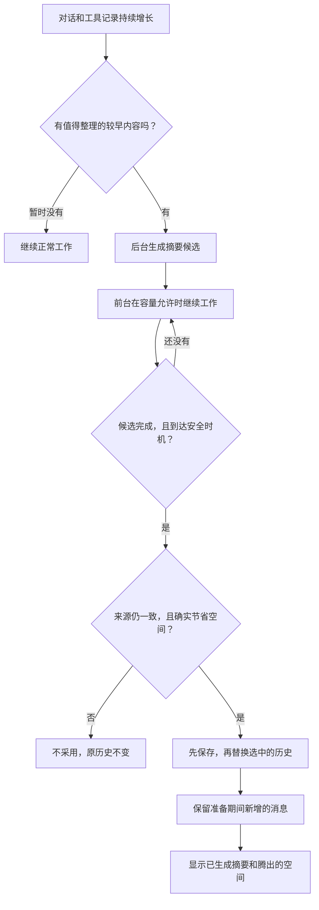
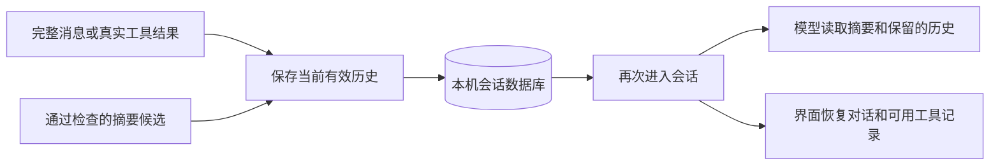

# 记忆与后台压缩

> 本文说明仓库当前实现。使用已发布版本时，请同时核对对应的发行说明；客户端能否展示相关状态，还取决于它接入的协议能力。

**Suna 会提前在后台整理较早的工具记录，尽量保留原始讨论和近期操作细节；工具记录已经难以腾出足够空间时，才归纳较早的对话。**目的是让长任务更连贯，少因丢失线索而重复读取、搜索或执行，而不是把所有历史尽早缩成一小段。

通常无需手动操作。你继续讨论和使用工具，Suna 在合适的时候准备摘要；真正采用后，界面才会显示腾出了多少对话空间。

日常使用读到[效果、成本和限制](#效果成本和限制)即可；旧版用户可看[升级说明](#升级与兼容性)，代码和参数说明放在文末的维护者参考。

## 先分清两种“记忆”

| | 当前会话的记忆 | 用户画像记忆 |
|---|---|---|
| 解决什么问题 | 记住这次任务的要求、决定、操作证据和进度 | 记住跨会话稳定的偏好、习惯和约束 |
| 举例 | “只改文档”“这个方案已被否决”“测试通过，但没做联网验证” | “回答先给结论”“代码注释使用中文” |
| 如何维护 | 随会话保存，必要时做后台压缩 | 从用户消息中提取候选，再由后台 worker 批量整理 |
| 如何使用 | 继续同一会话时供模型参考 | 在相关请求中作为背景提供 |
| TUI 入口 | 自动维护，也可用 `/compact` 手动整理 | `/memory` 查看和管理 |

两者不是同一份数据。**`/compact` 不会把项目过程自动写成跨会话画像，清空画像也不等于删除会话。**它们都不是完整聊天搜索或向量知识库。

## 它怎样帮助长任务？

假设 Suna 为一个问题读取了很多文件、运行了几次测试，又与你讨论了几轮方案。占空间最大的，往往是文件正文和重复日志，而不是你的几条要求。

Suna 会先整理这些较早的工具记录：

```text
整理前
你的要求 → 助手说明 + 工具参数 + 大段返回 → 后续讨论 → 近期工作

先整理工具后
你的要求 → 原助手说明 + 简洁的工具记录摘要 → 后续讨论 → 近期工作
           ↑ 原说明不改写                    ↑ 保留原文
```

工具摘要的目标不是只留一句“执行过测试”，而是保留后续判断需要的证据，例如：

> 检查了哪些文件，改了哪里；哪项测试通过，哪项未执行；错误发生的位置；还有什么无法确定。

这是说明摘要应保留什么的例子，不是对每次模型输出准确性的保证。

### 第一步：优先整理工具，少动讨论

- 优先处理**较早、完整，而且结果已经交给模型并完成一次后续响应**的工具组。不需要等整个任务结束。
- 保护近期操作现场；还没回答的用户消息、未返回完整的工具组和未完成的流式内容不能当作普通压缩来源。
- 被选中工具组对应的助手原说明逐字保留，工具参数和返回值替换成简洁的证据摘要。
- 已经很简洁或不适合压缩的工具组可以原样保留；不会为了显示“压缩成功”强行改写所有内容。
- 摘要模型按组回填证据。漏写、重复、给出计划外编号或声明可压缩却没给证据时，这些组按“不适合压缩”原样保留，整批仍可部分采用。

### 第二步：必要时再归纳较早对话

如果工具摘要仍不足以提供合理空间，Suna 才会把旧摘要和一段较早的连续历史合并，记录：

- 当前仍有效的要求、授权边界和决定；
- 被纠正或否决的旧方案，而不是把它们当成现行结论；
- 已完成、失败、计划中、尚未验证和未知的事项；
- 重要证据、图片来源和未解决的问题。

**程序先决定是否只整理工具、只归纳头部，或两者一起处理；同一轮用一个请求生成候选。**历史部分只发送唯一的旧摘要、确定要替换的连续头部和必要背景。模型不选择原话去留，也不返回用户保留编号。选区之外的用户／助手消息完整保留原顺序，头部内的工具不再单独重复整理。

被归纳头部内的逐字细节会退出有效历史；没有隐藏的原文档案可随时还原。尽量保留原始讨论，靠的是只选择必要头部，而不是让模型从大范围历史里挑几条原话。

## 后台准备，不等于已经替换

后台压缩可以与前台工作重叠，但不能任意改动正在使用的历史。它先写一份临时摘要草稿（下文称“候选”），检查通过后才替换选中的内容。



这里的“安全时机”是完整响应或工具批次之间、准备下一次模型请求的边界；没有模型请求或工具在途的空闲时刻，也可以采用已准备好的摘要。

几个容易误解的地方：

- **准备完成不等于空间已经释放。**候选只有通过检查并成功保存后才会采用。
- **不会用旧快照覆盖新消息。**准备期间追加的讨论和工具结果会保留。
- **后台生成失败不拖垮前台。**还有安全容量时，主任务可以继续；部分格式问题本地修复；每个候选只请求一次，失败保留原历史，退避后由后续模型请求前的维护边界重新规划，不在每个边界重复付费。
- **后台不能保证永不等待。**如果历史增长过快，下一次请求已经没有安全空间，就需要先等已有压缩完成；仍放不下或压缩失败时，会明确停止并报告，而不是偷偷删内容。

## 在界面上会看到什么？

| 情况 | TUI 表现 |
|---|---|
| 后台准备工具摘要 | 轻量提示“生成工具记录摘要”，不抢输入焦点，不替换正文 |
| 后台准备对话摘要 | 提示“生成较早对话摘要” |
| 同一候选包含两类来源 | 提示“生成工具记录与较早对话摘要”，仍是一轮整体操作 |
| 候选已准备好但尚未采用 | 还不下调上下文占用，不当作完成成果 |
| 已采用 | 显示“工具记录／较早对话已生成摘要”，以及腾出的估算 token 空间 |
| 手动整理失败、取消或没有合适来源 | 明确说明本次没有采用，保留原始错误诊断 |
| 可选后台生成失败或候选无收益 | 不打断聊天；诊断写入日志 |

后台维护不改变原有输入、排队消息、滚动、选区和工具展开方式。运行中发送的新要求仍在既有安全边界应用；普通摘要采用会暂缓，让模型先读取尚未处理的新用户要求。

### 手动 `/compact`

在当前会话空闲、你有控制权时，可以输入：

```text
/compact
```

它会：

1. 优先复用已准备好或正在准备的候选，不重复发起同一笔总结。
2. 没有候选时，由程序先估算工具收益，不足才把必要头部加入同一个请求。
3. 采用一份有意义的结果后结束，不为追求精确目标固定串行两次摘要。

手动操作可以绕过平时的准备／采用水位和失败退避，但仍须满足完整性、安全性及有意义的净收益。低占用会话按约五分之一释放量规划，实际不足约5%则不标记成功；较高占用按回落到约 `60% B` 规划，估算不保证精确命中。**点一次不保证一定压缩，也不保证小会话强制整理划算。**通常让自动维护工作即可，不必看到占用上升就反复执行。

### 取消和退出

- `Esc` 仍先关闭浮层或详情；没有这些界面时，取消当前运行也会结束相关摘要候选。没有新增“只取消后台压缩”的按钮。
- 已经成功保存和采用的摘要不会因迟到的取消回滚；已执行工具的外部副作用也不会回滚。
- 退出一个客户端不一定停止仍在运行的任务；无人使用的空闲会话运行态卸载后，未采用候选会结束。下次进入恢复的是已保存历史，不是上次的候选。
- 本地取消不保证模型服务立即停止计算或计费。

## 退出后还能恢复哪些内容？

Suna 保存的是**当前有效历史**，不是第二份完整操作录像。

完整用户消息、完整助手响应、工具声明和每条真实工具结果在各自的检查点保存；不是逐 token 写库，也不等整个任务结束才统一保存。

下面以主会话为例：



| 内容 | 再次进入会话时 |
|---|---|
| 未被归纳覆盖的用户／助手正文 | 恢复保留的正文 |
| 未压缩工具组 | 恢复保留的参数、状态和受展示上限约束的结果 |
| 已生成工具摘要的记录 | 显示工具名、原调用意图、真实返回状态和“已生成摘要”；不展开已经被替换的参数与结果 |
| 已归纳的较早历史 | 模型仍有一份连续性摘要及选区之外的原始对话；界面提示较早对话已摘要，不提供摘要全文查看入口 |
| 思考链、失败时未完成的流式输出、子任务内部过程 | 不作为完整历史持久化 |

当前屏幕不会因为后台采用就强制重画整段历史；重开后的内容可能更简洁。**工具返回成功只表示调用返回成功，不代表整个任务已经验证成功。**

真正中断的工具批次会保留已知结果，把缺少的结果标为未知，不伪造成功、失败或自动重跑。保存失败时，会停止下一次模型请求或新工具批次，同时回收已启动调用；已知但未保存的内存不能被旧数据库快照覆盖，继续或重新进入前必须先保存成功。

### 图片怎么处理？

图片在当前运行中仍可作为图片块发给模型；保存和历史整理时使用带完整 `source=` 的文字引用，并要求保留已有视觉结论和不确定性。

- 图片引用不是看图摘要，不能只凭文件名推断画面。
- 压缩不会为旧图重新调用看图模型，也不会因此删除附件。
- 以后模型可在需要时通过 `read_image` 读取来源；恢复时不会自动重发全部旧图。
- 当前运行中，本地／附件图片如果已被删除，实际解析时会将其从本次模型输入中省略；纯图片消息过滤为空也不发送。其他文字、正常图片、工具记录和持久历史保持不变，不增加说明消息或重试；同路径恢复后可再次读取。权限、安全校验、取消和其他错误仍正常返回，远程 URL 不作额外探测。
- 本地文件或外部 URL 可能变化、失效；保留引用不等于永久保存当时的像素。历史归纳中的逐项媒体引用保留依赖提示词，并非程序逐项核验保证。

## 效果、成本和限制

- **目标是更少无谓遗忘，不是零遗忘。**摘要可能遗漏旧细节，不能替代关键决定的正式文档；文件变更后的重读、修改后的复测仍然必要。
- **后台只是提前做，不是免费做。**摘要使用所属会话／子任务当前绑定的模型，会把所选历史发送给你配置的模型服务，并产生额外模型用量。准备后最终未采用，也可能已经产生费用。
- **不保证固定耗时、压缩率或总费用下降。**结果取决于历史内容、模型服务、输出额度和缓存行为；采用会改变一部分请求前缀，缓存可能需要重新建立。规划会按所需空间停止选区并去除重复背景，不机械拆成多批，也不为速度强制截短摘要或降低推理配置。失败后的后续重新生成仍可能增加费用。
- **上下文窗口仍有限。**当前输入、固定指令或必须保留的内容太大时，不能靠压缩保证任何请求都能放下。
- **主任务和子任务不共享历史。**两者共用整理规则，但各自处理独立上下文；子任务结束后回收其候选，不新增子任务独立持久化历史。

本地开销和可复现微基准见[性能文档](performance.md#会话整理的本地开销)。

## 升级与兼容性

**Suna 启动时会自动升级支持的旧数据库，不需要手动修改表或导入会话。**升级前退出客户端并停止旧 daemon，避免新旧程序同时写库。

- 直接支持新库、经 v0.31.0 正常初始化的旧库，以及已经升级的目标结构；更老结构需先用 v0.31.0 完成原有迁移。会话数据迁移在事务内执行，失败时回滚，不留下半升级的会话结构。
- 保留会话标识、元数据、已有摘要、已有正文与顺序；旧版没有保存的工具详情无法补造，旧 UI 工具聚合摘要不再保留。
- 自动迁移不包含自动备份。重要数据仍建议在停止旧 daemon 后做一致备份，尤其是需要回退时：旧程序不能安全写入新库，降级需恢复旧备份，也会失去升级后新增的对话。
- 数据库时间同时统一为明确带 `Z` 的 UTC；数字偏移只转换一次，时间点不变。时间升级失败时也回滚同次会话结构迁移，不改正文中的时间文字。新日志同样带 UTC 标记，旧日志不重写；排查规则见[时间与排查](development.md#时间与排查)。

## 维护者参考

以下是实现约束；日常使用不需要记住这些数值。

### 容量和调度

设模型总窗口为 `C`。程序先扣除当前请求的完整输出预留和边界余量，再扣估算安全垫，得到安全输入预算 `B`：

```text
usable = max(1, C - 当前请求 MaxTokens - max(2048, C / 200))
safety = 未校准时 max(8192, usable / 16)
         已校准时 max(2048, usable / 40)
B      = max(1, usable - safety)
```

完整占用包括 system、工具定义、历史摘要、消息、画像背景和图片估算。以本地估算乘校准系数判断，真实 usage 用于后续校准；TUI 占用比例的分母仍是 `C`，所以不能把界面百分比直接当成下面的水位。

| 普通自动维护规则 | 当前值与含义 |
|---|---|
| 初次准备候选 | 占用约达到 `60% B`，有值得整理的来源且取得共享槽时 |
| 普通采用候选 | 占用约达到 `75% B`；工具、历史、组合计划都延后采用 |
| 期望回落位置 | 约 `60% B`；规划净释放 `max(当前占用, 75% B) - 60% B` |
| 目标容忍 | 最多约 `2% B`，且不超过释放目标的五分之一；不为微小缺口多压原话 |
| 近期保护 | 从末尾至少保护 `10% B`；两类来源均不跨入受保护消息／工具组 |
| 普通最低净收益 | 预计和实际约 `2% B`；不为没有收益的小组发请求 |
| 后续准备 | 仍按固定 `60% B` 准备，复用在途／就绪候选；不用固定新增8%冷却或动态准备线 |

每个独立上下文最多一份在途或就绪候选，主／子任务共用一个生成槽；普通无槽就跳过，不排队积压历史快照。一次计划可为 `tools`、`history` 或 `mixed`。程序先选工具到预计够用为止，不足时扩选最短安全头部，移除重叠工具；必要时让出末尾独立工具的请求容量，避免工具占满后无法加入必要头部。只发送所选来源与位置去重的必要背景。只有更新历史时携带旧摘要，不发送完整未选中后缀。

输入预算计完整序列化请求，收益预算计主上下文实际将被替换的内容；保留的助手正文不能算作工具可释放量。正文输出预留约来源的三分之一，仍受显式 binding 能力限制；这不是强制摘要长度，更不是 reasoning 总额度。来源装不下时按完整边界选择可用计划，不硬裁来源、不默认串行拆批。

无收益的同源计划不会因追加无关尾部重新收费；没有有效观察的工具组可被排除，历史仍只在必要时作为组合计划的一部分。失败后普通准备至少退避30秒，手动和硬容量可越过退避；切换模型路由重置这些局部抑制状态；已退出有效历史的工具指纹会清理，不按会话寿命无限累积。

手动和硬容量等待复用已有候选，不重置候选期限。新计划正常只生成、采用一份；只有接管旧候选期间新增后缀使采用后仍超限，才允许一次紧急重规划，不能无限串行付费。生成总期限为20分钟（含排槽），流空闲超时5分钟；每个候选只发一次请求，不在生成内部自动重试。普通失败不终止有容量的主任务，退避到期后仅在后续维护边界重新规划；不是定时器自动发请求，也不保证每个 turn 重发。手动／硬容量等待失败直接报告，不能假设还会自动进入下一 turn；取消不重试，槽直到旧本地流真正关闭才释放。

### 数据与职责

| 层 | 负责什么 |
|---|---|
| `memory` | 单份历史类型、持久化、确定性选区与替换、摘要生成 |
| `runner` | 完整预算、水位、候选调度、模型／工具之间的安全边界 |
| `agent` | 具体会话的保存、恢复、取消与空闲协调 |
| daemon／protocol／TUI | 请求准入、状态通知、快照和展示，不维护第二份模型历史 |

`memory.Message` 是内存和数据库共用的历史类型；转为 `model.Message` 才参与模型请求，转为 protocol 快照才供 UI 展示。工具观察正文只保存一份；工具标签只用于恢复展示，不进入模型请求。旧的纯文本操作观察不靠文本猜测工具身份来复原。

`session_state` 每会话一行，字段为 `session_id / summary / messages / updated_at`。旧列 `compacted_state → summary`、`last_messages → messages`，删除 `tool_summary`；改列与历史规范化在同一事务完成，坏 JSON 导致回滚。没有原文归档、新权威表、版本号或双写路径。

后台候选不写库、不改当前历史。采用前复核全部来源、输出格式、完整结束状态和真实净收益；主会话先落库再更新 RAM／发布 `applied`，子任务仅更新自身内存。完整围栏和额外字段可本地容错；缺失、重复、空白或错误类型的工具条目保留原组。历史摘要无效或反而增大时保留整个头部，独立有效工具仍可采用；`applied.kind` 表示实际采用范围。截断响应、保存失败不能标记成功，也不会提交部分 JSON 或静默删除原文。

### 代码与协议入口

- `internal/memory/history.go`、`messages.go`：历史类型、模型投影、媒体引用和中断恢复。
- `internal/memory/compact_plan.go`、`compact_apply.go`、`compact_wire.go`、`compress.go`：统一选区、精确替换、请求投影与摘要生成。
- `internal/memory/conversation.go`、`session_migration.go`：保存、加载和升级。
- `internal/runner/context_budget.go`、`context_memory.go`：预算与候选生命周期。
- `internal/agent/memory.go`：检查点和会话协调。
- `internal/prompt/templates/compress.md`：一份模板，按明确区域生成历史摘要与工具观察。
- 客户端使用 `session.compact` 和 `session.compact_state`，详见 [Protocol](protocol.md#sessioncompact)；不要通过展示文案判断状态。
